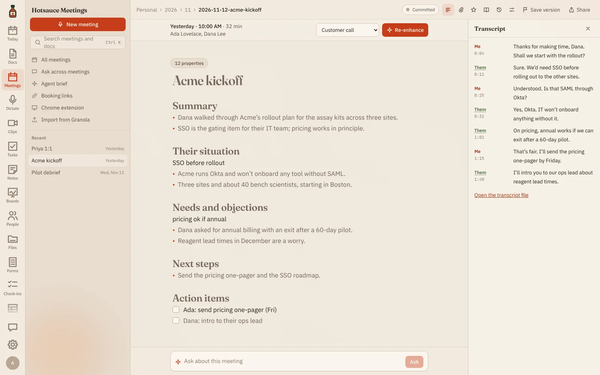
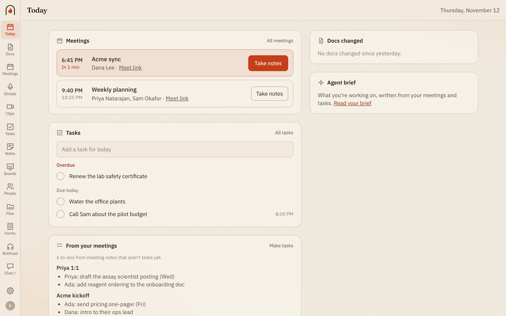
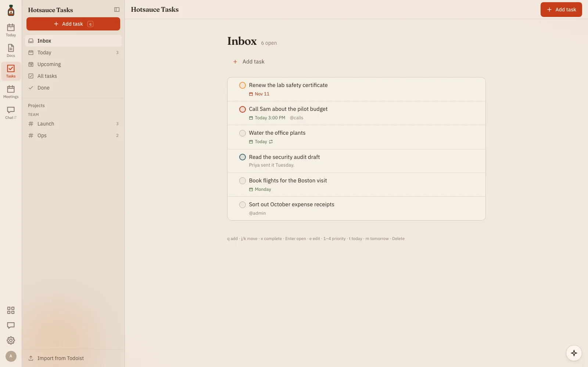
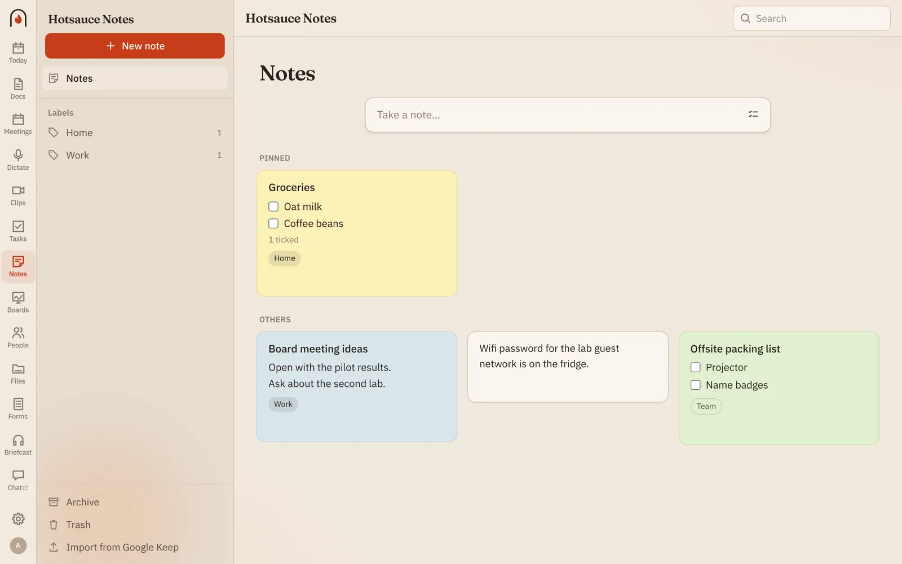
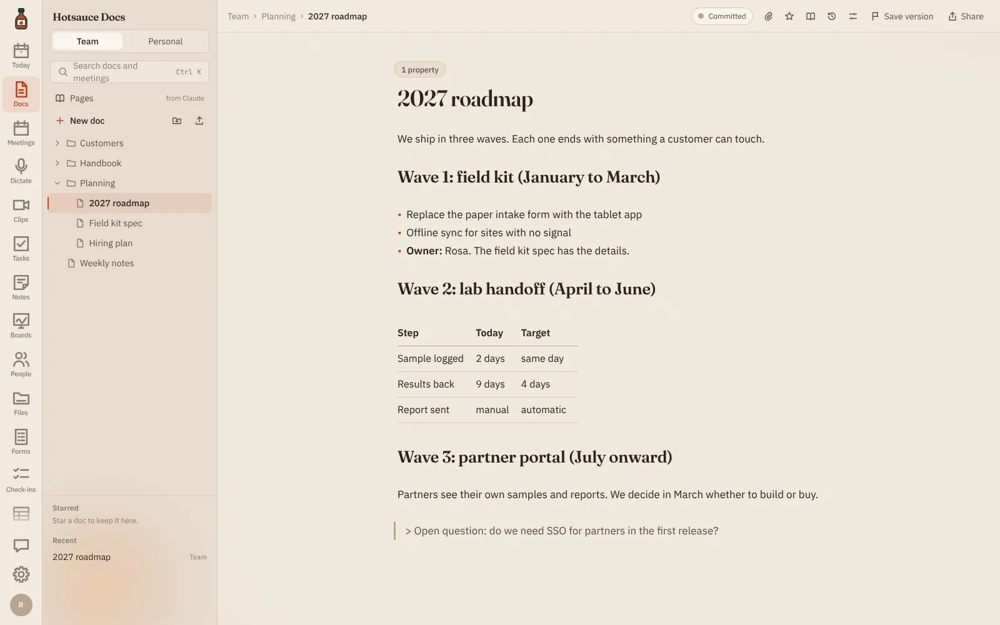
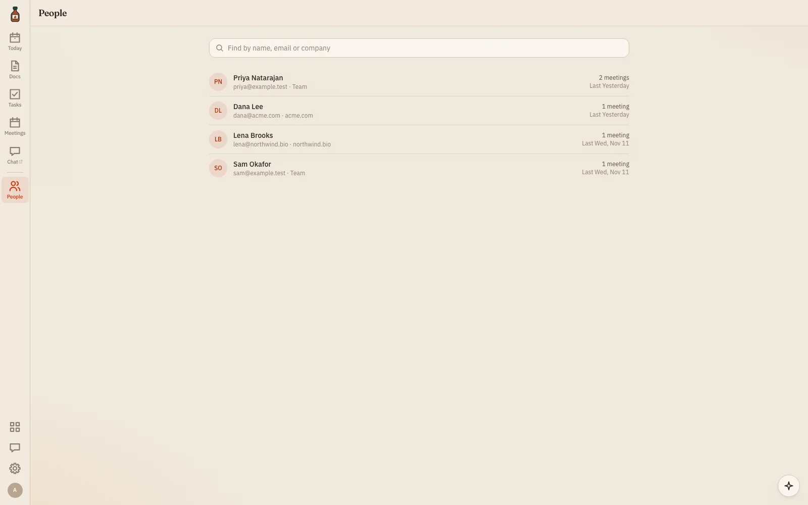
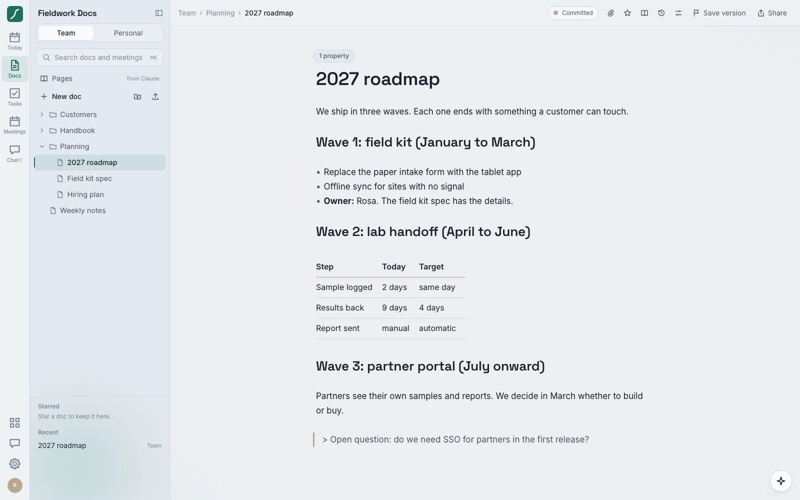
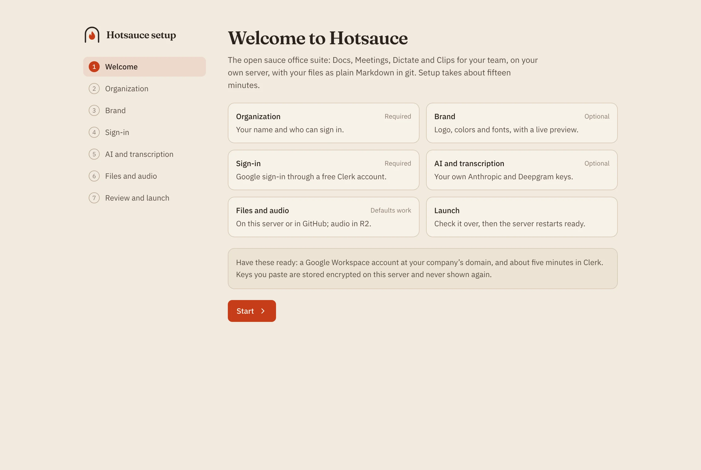

<h1 align="center">Hotsauce</h1>

<p align="center">
  <b>The open sauce office suite.</b><br>
  Docs, AI meeting notes, tasks, notes, whiteboards, dictation and screen recordings for a small team,<br>
  on a server you run, with every file kept as plain Markdown in git.
</p>

<p align="center">
  <a href="https://hotsauce.work">hotsauce.work</a> ·
  <a href="#whats-in-the-box">Apps</a> ·
  <a href="#why-hotsauce">Why Hotsauce</a> ·
  <a href="#what-it-costs">What it costs</a> ·
  <a href="#get-started">Get started</a> ·
  <a href="docs/self-host.md">Self-hosting guide</a>
</p>

<picture>
  <source media="(prefers-color-scheme: dark)" srcset="docs/screenshots/meeting-dark.webp">
  
</picture>

<p align="center"><sub>The people, companies and conversations in these screenshots are made up.</sub></p>

## Why Hotsauce

**Your files stay yours.** Every doc, meeting note, task and note is a Markdown file in a git
repository, on your server or in your GitHub organization. Open it in any editor, grep it, back it up,
walk away with it. The database is only a search cache: delete it and Hotsauce rebuilds it from git.

**Pay for the AI you use, not per seat.** Hotsauce is free and open source. Bring your own Anthropic and
Deepgram keys; a small team spends a few dollars a month on them.

**One suite instead of a stack of subscriptions.** Docs, a meeting notetaker, a task list, dictation,
screen recording and more share one sign-in, one search, one brand and one place your team's knowledge
lives.

**Agents are first-class.** A built-in MCP server lets Claude and other agents search, read and write
your docs, meetings, tasks, clips and files as you, with the same permissions you have.

## What's in the box

### Today

The home page: your meetings for the day with one click to take notes, tasks due and overdue, to-dos
from your meeting notes that aren't tasks yet, docs that changed since yesterday, and your agent brief.

<picture>
  <source media="(prefers-color-scheme: dark)" srcset="docs/screenshots/today-dark.webp">
  
</picture>

### Meetings

AI meeting notes for Google Meet and in-person calls. Record in the browser, with the Chrome extension,
or from the Mac app, which records any call with the whole Mac's audio. Watch the transcript arrive live
with speaker names from the invite, jot your own notes, and Hotsauce writes clean notes from them using
templates for customer calls, interviews and stand-ups. Also in Meetings:

- **Ask** questions across every past meeting.
- **Agent brief:** a page about what you're working on, written from your meetings and tasks.
- **Booking links:** share your free times and let people book a call, checked against your calendar.
- **Google Calendar** reminders before each call, and **Import from Granola** to bring your history.
- **Voice notes from your phone:** add the page to your home screen and record up to two hours.

### Tasks

A fast task list with quick add (`Send the deck fri p1 #Launch`), projects, recurring tasks, and the
action items from your meetings one click away. Talk through everything on your mind and it splits it
into tasks. Import from Todoist.

<picture>
  <source media="(prefers-color-scheme: dark)" srcset="docs/screenshots/tasks-dark.webp">
  
</picture>

### Notes

Quick notes and checklists on colored cards, with labels, pins and an archive. Import from Google Keep.

<picture>
  <source media="(prefers-color-scheme: dark)" srcset="docs/screenshots/notes-dark.webp">
  
</picture>

### Docs

Markdown documents with a fast, source-first editor. Several people edit at once, every save is a git
commit with a readable history, links survive renames, and search covers every space you can see.
Import Markdown, Word and HTML files, and drop live task lists into a page.

<picture>
  <source media="(prefers-color-scheme: dark)" srcset="docs/screenshots/default-docs-dark.webp">
  
</picture>

### Everything else

| App | What it does |
| --- | --- |
| **People** | Everyone you meet with, from your calendar and meeting notes: past and next meetings, open to-dos, and a short note about each person. |
| **Whiteboard** | Hand-drawn boards the whole team can draw on at once, saved as files you can search. |
| **Files** | Upload and share files and folders, with previews and search across what's inside them. |
| **Forms** | Surveys, sign-ups and requests for your team or anyone with the link. Answers land in Hotsauce, where you can search them. |
| **Share pages** | Share a read-only link to a doc, note or meeting, or publish a page. |
| **Clips** | Loom-style screen recordings with a camera bubble, a transcript, a summary, speed control and a shared library. |
| **Dictate** | Hold a key on your Mac, talk, and clean punctuated text lands wherever your cursor is. Team word lists keep names spelled right. |
| **Briefcast** | A five-minute audio briefing each weekday morning: your meetings, what changed and what's due, in your podcast app. |

<picture>
  <source media="(prefers-color-scheme: dark)" srcset="docs/screenshots/people-dark.webp">
  
</picture>

### Make it yours

Name the workspace after your company, add your logo, and pick colors, fonts and a default light or
dark look. Every app follows, and agents can read the brand kit too, so what they write sounds like
you. Invite people from outside your company by email.

<picture>
  <source media="(prefers-color-scheme: dark)" srcset="docs/screenshots/branded-docs-dark.webp">
  
</picture>

## Hotsauce and the usual stack, side by side

| | Hotsauce | Typical stack |
|---|---|---|
| **Price** | Free and open source. You pay for hosting and your own AI usage | A per-person subscription each for docs, meeting notes, tasks, dictation and screen recording |
| **Where your files live** | Markdown in git, on your server or in your GitHub organization | Each vendor's cloud, in each vendor's format |
| **Leaving** | Copy the repository | An export per app |
| **Agents** | Built-in MCP server across the suite | Varies by app |
| **Branding** | Name, logo, colors, fonts, default look | Workspace name and icon |
| **Source code** | AGPL-3.0, on GitHub | Closed |

## What it costs

| | Monthly |
|---|---|
| Hosting on Fly.io (one small machine, 3 GB disk) | about $6 |
| *or* hosting on Cloudflare (Workers Paid plus a small always-on container) | about $13–15 |
| Anthropic (meeting notes, Ask, cleanup) for a team of ten | a few dollars |
| Deepgram (transcription) | a few dollars |
| Cloudflare R2 for video, audio and files | free up to 10 GB |

## Get started

### Fly.io (about $6 a month)

You need [Node 22](https://nodejs.org), [pnpm](https://pnpm.io) and a free [Fly.io](https://fly.io)
account.

```sh
git clone https://github.com/hotsauce-suite/hotsauce && cd hotsauce
pnpm install
scripts/deploy-fly.sh acme-office          # your app name
```

Open the setup link it prints. A wizard walks you through your organization, brand, Google sign-in
(through a free Clerk account), AI keys and storage, then launches. It takes about fifteen minutes.



### Cloudflare (new)

[](https://deploy.workers.cloudflare.com/?url=https://github.com/hotsauce-suite/hotsauce)

1. Switch your Cloudflare account to [Workers Paid](https://dash.cloudflare.com/?to=/:account/workers/plans)
   ($5 a month). Containers need it.
2. Click the button. Cloudflare copies Hotsauce to your GitHub and asks for a name, an R2 bucket, a
   **setup password** you make up, and a **master key** (a long random string you keep safe). The
   first build takes about ten minutes.
3. Open your new `workers.dev` address with `/setup` on the end and enter your setup password.

On Cloudflare the server's disk is wiped whenever it restarts, so your repositories live in a GitHub
organization and videos and audio in R2. Hotsauce keeps its own settings in the R2 bucket. The
[self-hosting guide](docs/self-host.md#cloudflare-about-1315-a-month-always-on) has the details.

### Docker

`cd deploy && docker compose up -d` runs the same thing anywhere Docker does. The
[self-hosting guide](docs/self-host.md) covers every option, plus custom domains and backups.

### Stay up to date

Each copy has an **Update Hotsauce** workflow that checks every Monday for a new release and opens a
pull request with it, keeping your own changes. Merging deploys it: Cloudflare redeploys on every push,
and on Fly a workflow does it once you add a deploy token. See
[Staying up to date](docs/self-host.md#staying-up-to-date).

### Try it on your computer

You need Node 22, git, and pnpm 10 via `corepack enable`.

```sh
corepack enable
pnpm install
pnpm dev
```

Open http://localhost:5173 and sign in as any `@example.test` address. Nothing leaves your machine:
transcription and AI use deterministic fakes unless you set
`ASR_PROVIDER=deepgram DEEPGRAM_API_KEY=… LLM_PROVIDER=anthropic ANTHROPIC_API_KEY=…`.

## Built to last

- **Git is the source of truth.** If something can't survive deleting the database and reindexing, it
  doesn't belong in the database.
- **Your Markdown, untouched.** Hotsauce never reformats files it didn't write, and patches front matter
  in place.
- **Tested hard.** Every integration test runs against both GitHub and Forgejo, and Playwright drives the
  main journeys in a real browser.
- **Fast by default.** Performance budgets are part of the spec, not an afterthought.

## Docs

- [Self-hosting guide](docs/self-host.md): Fly, Cloudflare, Docker, the setup wizard, updates, and
  configuring by environment.
- [Architecture](docs/ARCHITECTURE.md): how it fits together, app by app.
- [MCP server](docs/mcp.md): connecting Claude and other agents.

### Developing

```sh
pnpm lint && pnpm typecheck
pnpm test                    # unit + integration (Vitest)
pnpm build && pnpm test:e2e  # Playwright, against the built app
```

Hotsauce started as an internal tool called Hearth, so package names, some identifiers and the git
trailer `Hearth-Via` still say "hearth". They're stable on purpose: files written by older versions keep
working.

`site/` is [hotsauce.work](https://hotsauce.work), static pages on Cloudflare Workers.

## Contributing

Issues and pull requests are welcome; see [CONTRIBUTING.md](CONTRIBUTING.md). Report security problems
privately: see [SECURITY.md](SECURITY.md).

## License

[AGPL-3.0](LICENSE). © 2026 Morgan Holland. You can run, change and share Hotsauce freely. If you offer a
changed version to others over a network, share your changes under the same license.
